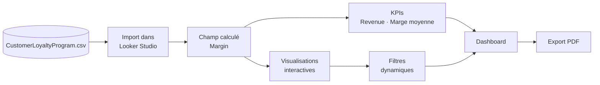

# Tableau de bord Looker Studio : ventes et fidélité client

> Un dashboard interactif de bout en bout : des **KPIs**, **4 visualisations** avec drill-down et filtres dynamiques, pour analyser les ventes et le programme de fidélité d'une entreprise.


## En bref

| | |
|---|---|
| **Objectif** | Concevoir un dashboard analytique et interactif pour suivre les ventes, les marges et la fidélité client |
| **Données** | `CustomerLoyaltyProgram.csv` : ventes, produits, clients et statut de fidélité ([nombre de lignes à compléter]) |
| **Indicateurs** | Revenue total, marge moyenne |
| **Visualisations** | Bar chart avec drill-down, top 10 des villes, bar chart horizontal, pie chart |
| **Livrable** | Dashboard interactif + export PDF (`Advanced_Dashboard.pdf`) |
| **Contexte** | [Cours / projet personnel / formation : à compléter] |

## Ce que le projet démontre

- **Préparation des données** : import d'un CSV et création d'un champ calculé (`Margin`) pour enrichir l'analyse.
- **Pilotage par les KPIs** : des scorecards qui donnent la performance globale en un coup d'œil.
- **Exploration interactive** : drill-down et filtres dynamiques pour passer d'une vue globale à un détail précis, sans refaire de requête.
- **Analyse client** : lecture des ventes à travers la fidélité (Loyalty Status).
- **Communication des résultats** : mise en page, couleurs et typographie travaillées, plus un export PDF prêt pour le reporting.

## Aperçu du dashboard

📷 [Ajouter ici une capture d'écran : ``]

📄 Version complète : [`Advanced_Dashboard.pdf`](Advanced_Dashboard.pdf)
🔗 Dashboard en ligne : [lien Looker Studio à ajouter, si le partage est public]

## Méthode



## Ce qui a été construit

### Champ calculé
`Margin = Unit Sale Price - Unit Cost`

### KPIs (scorecards)
- Revenue total
- Marge moyenne

### Visualisations

| Visualisation | Ce qu'elle montre |
|---|---|
| 📊 Bar chart avec **drill-down** | Revenue par Product Line, puis par Location Code |
| 📊 Top 10 | Les 10 villes qui génèrent le plus de ventes |
| 📊 Bar chart horizontal | Marge par année et par Product Line |
| 🥧 Pie chart | Répartition des clients par Loyalty Status |

### Interactivité
Des filtres dynamiques permettent de croiser les dimensions (produit, lieu, année, fidélité) et de mettre à jour tous les graphiques en même temps.

## Résultats et enseignements

> À compléter avec **tes vrais chiffres** : c'est la partie qui fait la différence auprès d'un recruteur.

- Revenue total : **[valeur]**
- Marge moyenne : **[valeur]**
- Product Line la plus rentable : **[nom]**
- Ville en tête des ventes : **[nom]**
- Part des clients par statut de fidélité : **[ex. X % pour le statut Y]**

## Démarrage rapide

1. Ouvrir [`Advanced_Dashboard.pdf`](Advanced_Dashboard.pdf) pour voir le rendu final.
2. Pour le refaire : importer `CustomerLoyaltyProgram.csv` dans Looker Studio (*Créer → Source de données → Importer un fichier*).
3. Ajouter le champ calculé `Margin`, puis recréer les graphiques décrits ci-dessus.

## Structure du projet

```
├── CustomerLoyaltyProgram.csv   # jeu de données source
├── Advanced_Dashboard.pdf       # export final du dashboard
├── images/                      # captures d'écran
└── README.md
```

## Compétences mises en œuvre

`Google Looker Studio` · `Business Intelligence` · `Data Visualization` · `Dashboarding` · `KPI` · `Champs calculés` · `Drill-down` · `Filtres dynamiques` · `Analyse des ventes` · `Analyse de la fidélité client` · `Data Storytelling` · `Reporting`

## Limites et pistes d'amélioration

- Les données viennent d'un **CSV importé** : le dashboard n'est pas actualisé automatiquement. Piste : le connecter à **Google Sheets** ou **BigQuery** pour des mises à jour en continu.
- La marge est calculée **par unité** (prix de vente − coût). Piste : ajouter un **taux de marge (%)** et une marge pondérée par les quantités vendues.
- Piste suivante : ajouter une analyse de l'évolution dans le temps (tendances, saisonnalité) et une segmentation plus fine des clients fidèles.

## Auteur

**Adama Fall** · [LinkedIn / email à ajouter]
